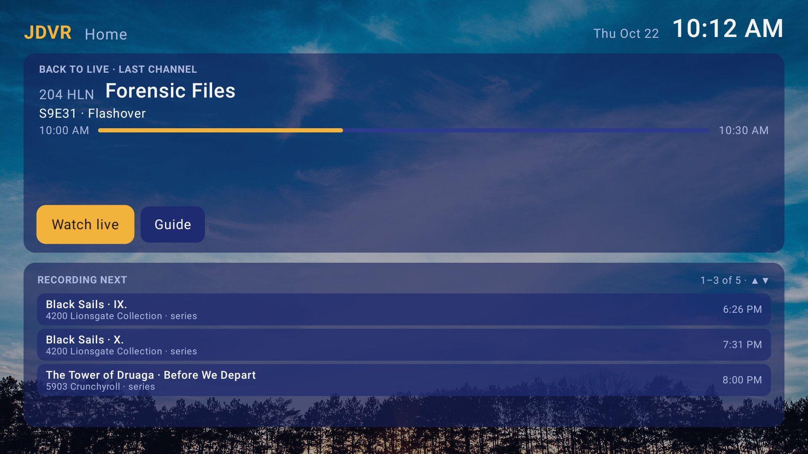
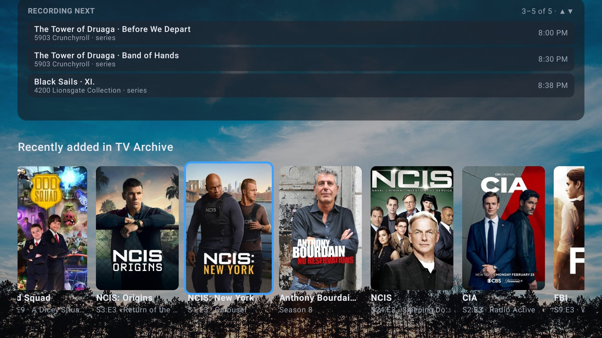
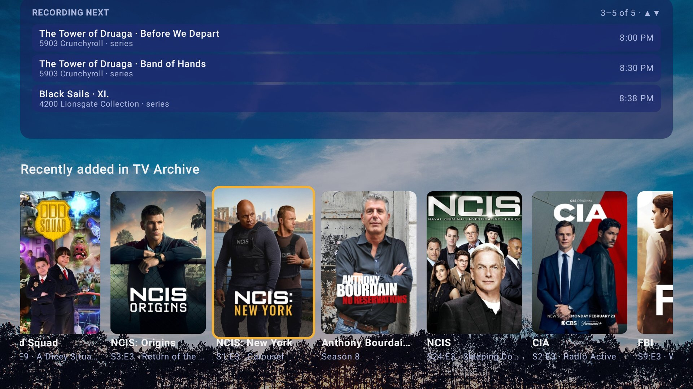
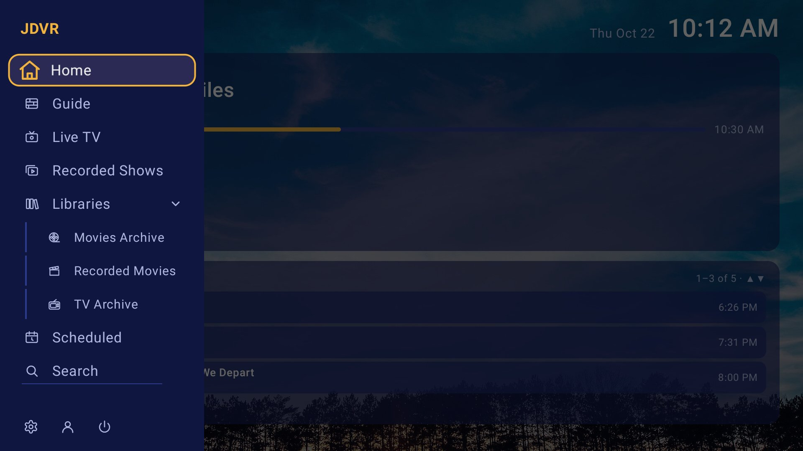
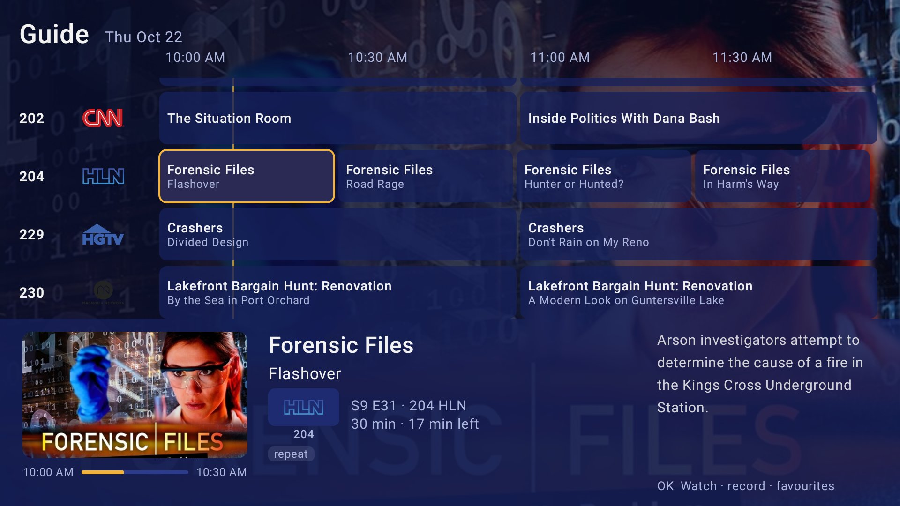
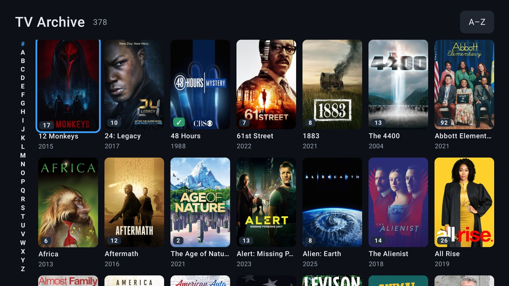
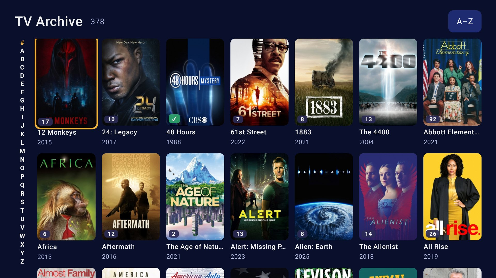
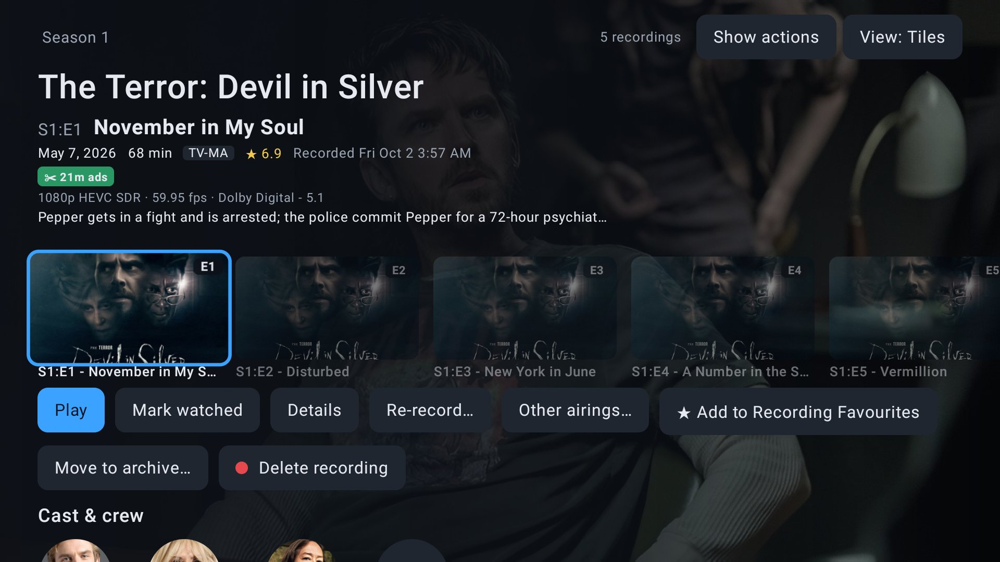
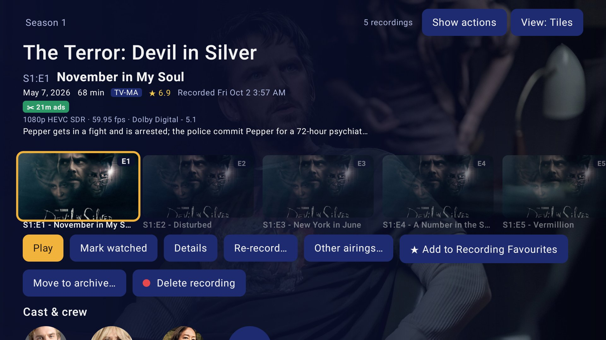
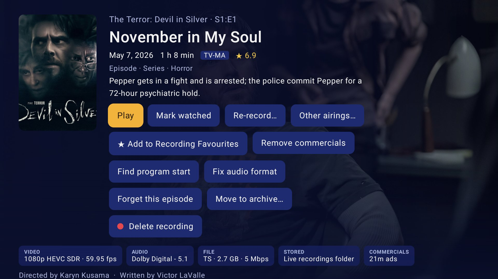

# JDVR — a Jellyfin DVR client for Android TV

A TV client for Jellyfin's live TV and DVR: live TV and a guide first, recordings next. It works
with any Jellyfin server (10.11 or 12), and does more with a few optional server plugins (below).

**Experimental:** used every day on one household's server, but young. Expect rough edges, and
please open an issue when something breaks.

## Install

Android TV 6 or newer (Google TV, Shield, Fire TV, onn and other Android TV boxes). JDVR isn't in
an app store: install the APK yourself.

1. On the TV, install the **Downloader** app (from the Play Store or Amazon Appstore) and allow it
   to install apps when it asks (Settings › Apps › Special app access › Install unknown apps).
2. In Downloader, open
   `https://github.com/mackandall/jdvr-client/releases/latest/download/jdvr.apk` and install.
3. Open JDVR: it finds Jellyfin servers on your network, or type the address. Sign in with Quick
   Connect (approve the code in the Jellyfin web client) or a password.

To update, do step 2 again: the same address always gives the latest version, and it installs
over the old one without signing you out. From a computer instead: `adb install -r jdvr.apk`.
Each [release](https://github.com/mackandall/jdvr-client/releases) lists what changed and the
APK's SHA-256.

## Works best with

All optional: without one, JDVR falls back to Jellyfin's own features or says what's missing.
**Settings › Server features** in the app shows which ones your server has. The JellyDVR plugins
are all in one plugin repository: Jellyfin dashboard › Plugins › Repositories › add

```
https://raw.githubusercontent.com/mackandall/jdvr-client/main/plugins/manifest.json
```

then Plugins › Catalog › install the ones you want, and restart Jellyfin. (Intro Skipper has its own
repository, below.)

| Plugin | What it adds in JDVR | Source |
|---|---|---|
| Comskip Commercial Segments | Commercials found and skipped (also while recording), ✂ badges, program start, recording edits | [repo](https://github.com/mackandall/jellyfin-plugin-comskip-segments) |
| Intro Skipper | Intros, recaps and previews found and skipped | repository `https://intro-skipper.org/manifest.json` |
| Episode History | New recordings on Home, Recorded Shows by show, watched / in library / recorded marks in the guide, Forget this episode | [repo](https://github.com/mackandall/jellyfin-plugin-episode-history) |
| JellyDVR Schedule | Tuners in use, "all tuners are busy" before tuning, conflicts and priorities, Recording Favourites | [repo](https://github.com/mackandall/jellyfin-plugin-jellydvr-schedule) |
| JellyDVR Live | Pause and rewind live TV past when you tuned in; keep what you're watching | [repo](https://github.com/mackandall/jellyfin-plugin-jellydvr-live) |
| JellyDVR Space | Move to archive…, keeping the recordings drive from filling up | [repo](https://github.com/mackandall/jellyfin-plugin-jellydvr-space) |
| XMLTV Guide Cleaner | Cleaner movie titles in the guide (for guides that put the year in the title) | [repo](https://github.com/mackandall/jellyfin-plugin-xmltv-cleaner) |

## What's in it

- Kotlin, Compose for TV, Media3, Jellyfin SDK. No DI framework.
- Sign in with Quick Connect (approve the code from the web client) or a password.
- Live TV: channel list with what's on; player with channel up/down, number entry, info bar;
  asks JellyDVR Schedule whether a tuner is free first ("All tuners are busy").
- Guide: 2-hour window, Episode History marks as chips, programme panel with Watch, Record,
  Record series, Record this instead, Recording Favourites.

## Screenshots

Taken on a real server, TV shows only, in two of the themes: *Midnight* (the default) and
*MythTV Blue*.

| | Midnight | MythTV Blue |
|---|---|---|
| Home |  |  |
| Home, a library's row |  |  |
| Menu |  |  |
| Guide |  |  |
| TV library |  |  |
| A show's recordings |  |  |
| TV episode details |  |  |

Build: `JAVA_HOME=~/opt/jdk21 ANDROID_HOME=~/Android/Sdk ./gradlew :app:assembleDebug`
(installs as `com.mackandall.jdvr.debug`, beside Wholphin).
Release: raise `jdvr.version` in `gradle.properties`, commit and push, then `./release.sh` builds
the signed APK and makes a draft GitHub release with it.

GPL-2.0: `app/src/main/java/com/mackandall/jdvr/profile` comes from Wholphin / Jellyfin Android TV.
