# JDVR — a Jellyfin DVR client for Android TV

A TV client built around the JellyDVR server plugins (Schedule, Live, Episode History, Comskip):
live TV and a guide first, recordings next.

- Kotlin, Compose for TV, Media3, Jellyfin SDK. No DI framework.
- Sign in with Quick Connect (approve the code from the web client) or a password.
- Live TV: channel list with what's on; player with channel up/down, number entry, info bar;
  asks JellyDVR Schedule whether a tuner is free first ("All tuners are busy").
- Guide: 2-hour window, Episode History marks as chips, programme panel with Watch, Record,
  Record series, Record this instead, Recording Favourites.

## Screenshots

Two of the themes: *Ode to Emby's Apple* (light) and *Midnight* (dark).

| | Ode to Emby's Apple | Midnight |
|---|---|---|
| Home | 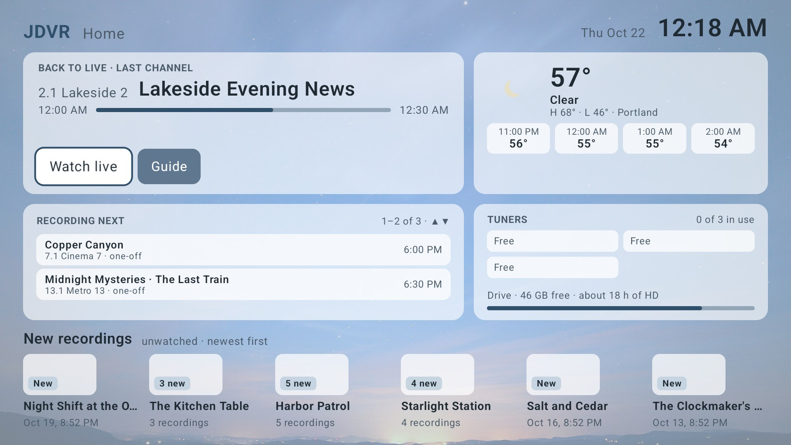 | 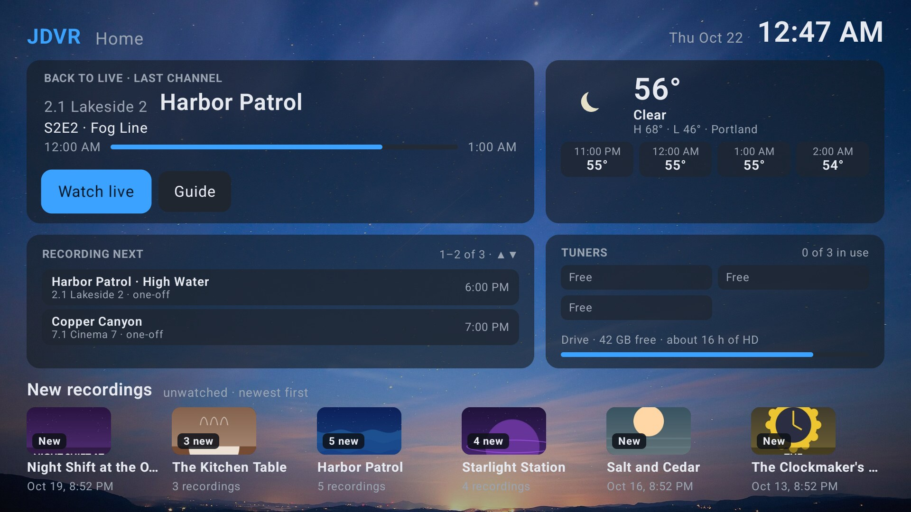 |
| Menu | 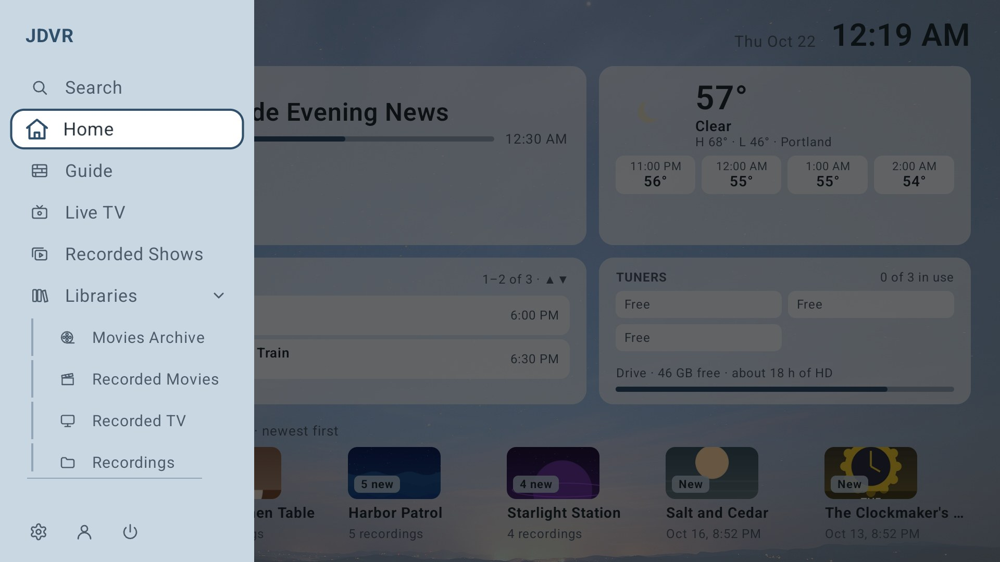 | 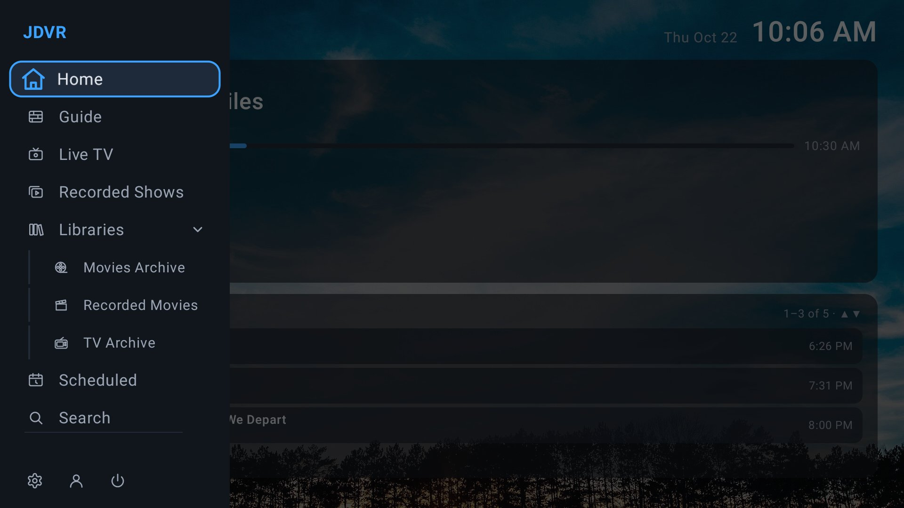 |
| Guide | 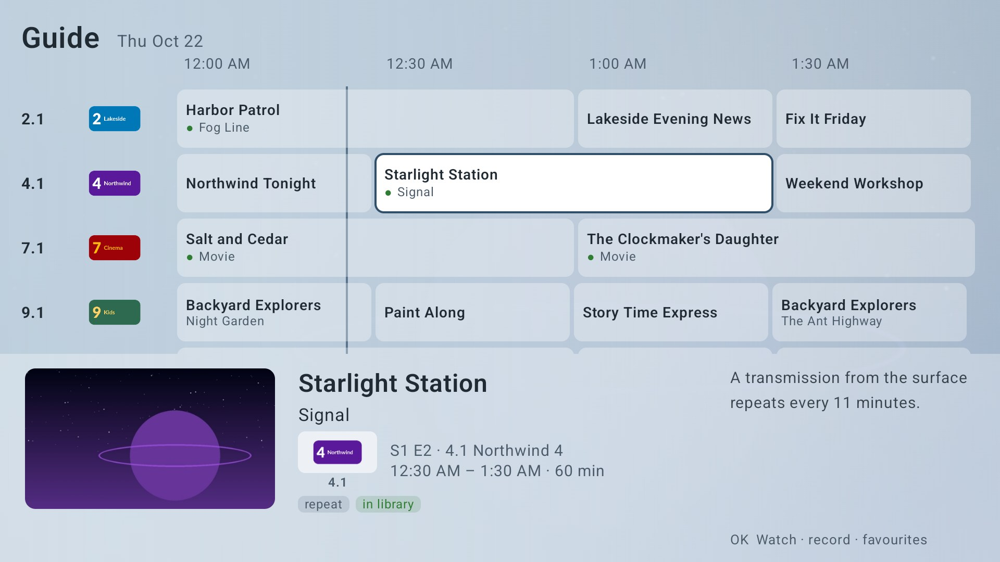 | 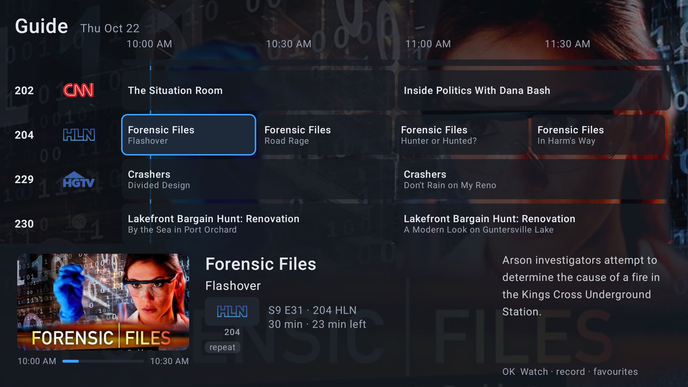 |
| Recorded Shows | 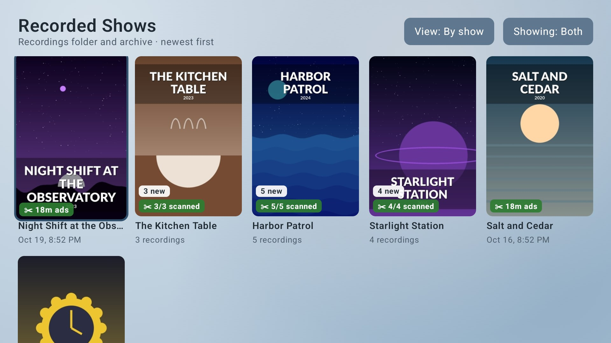 | 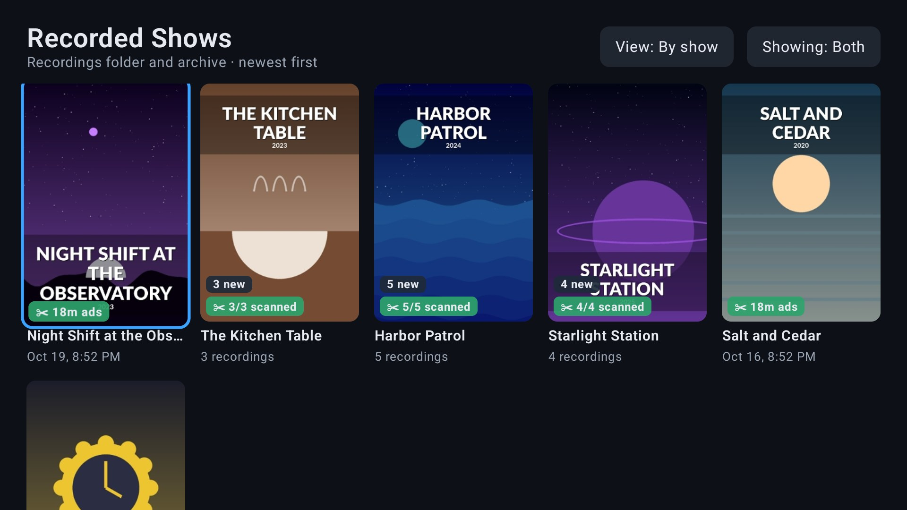 |
| A show's recordings | 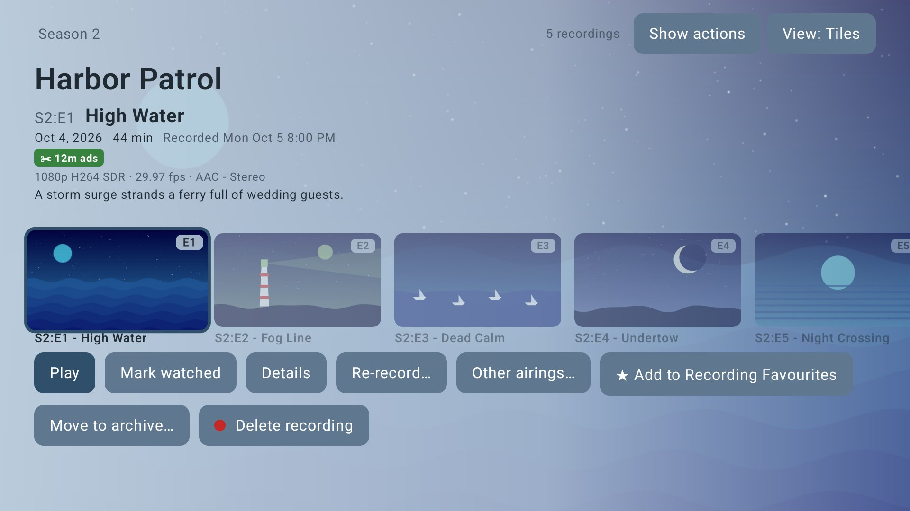 | 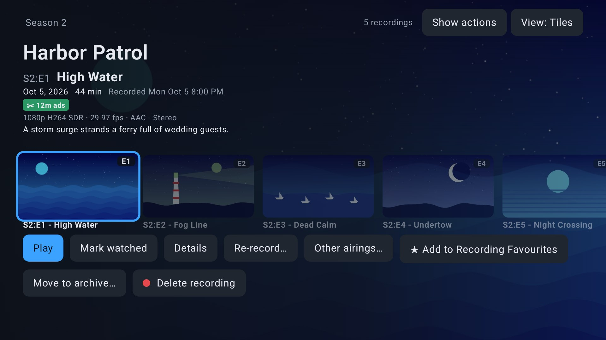 |
| TV episode details | 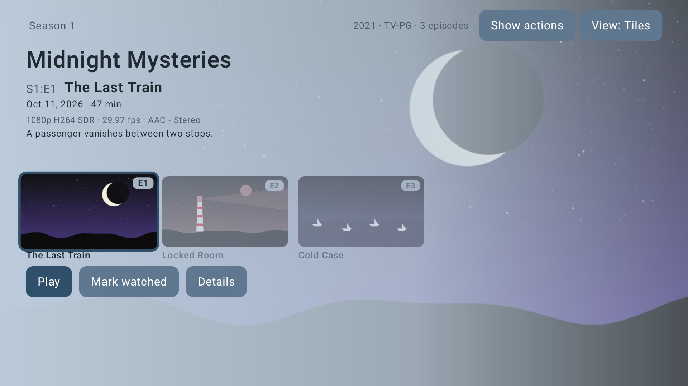 | 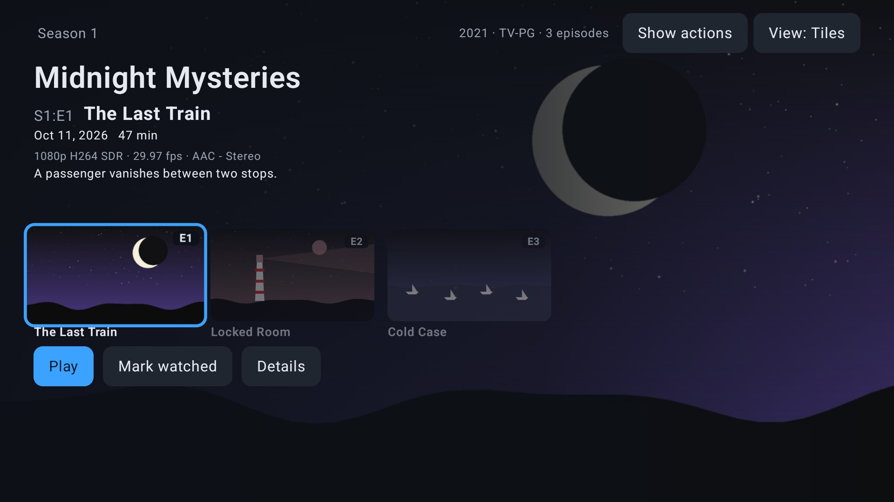 |
| Movies Archive | 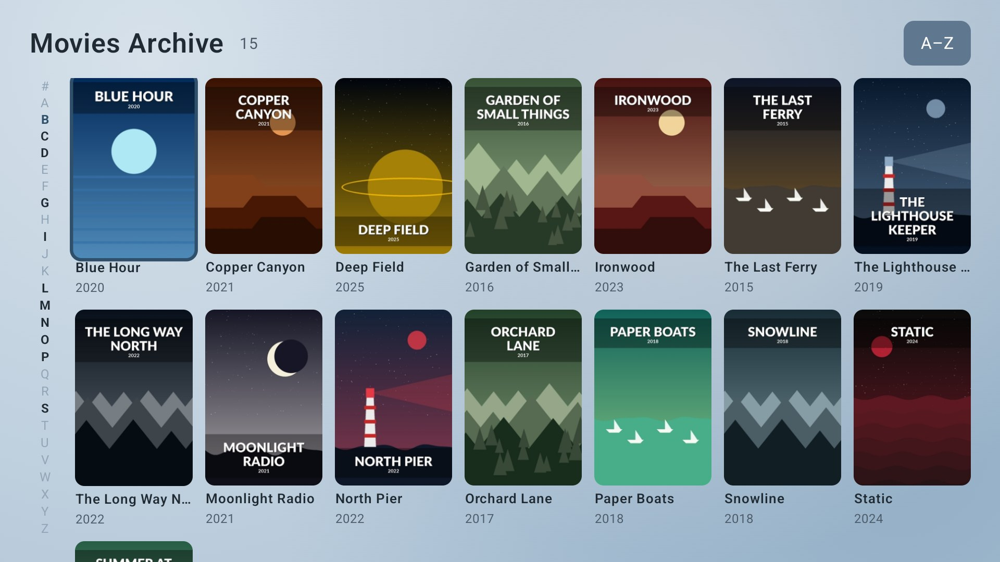 | 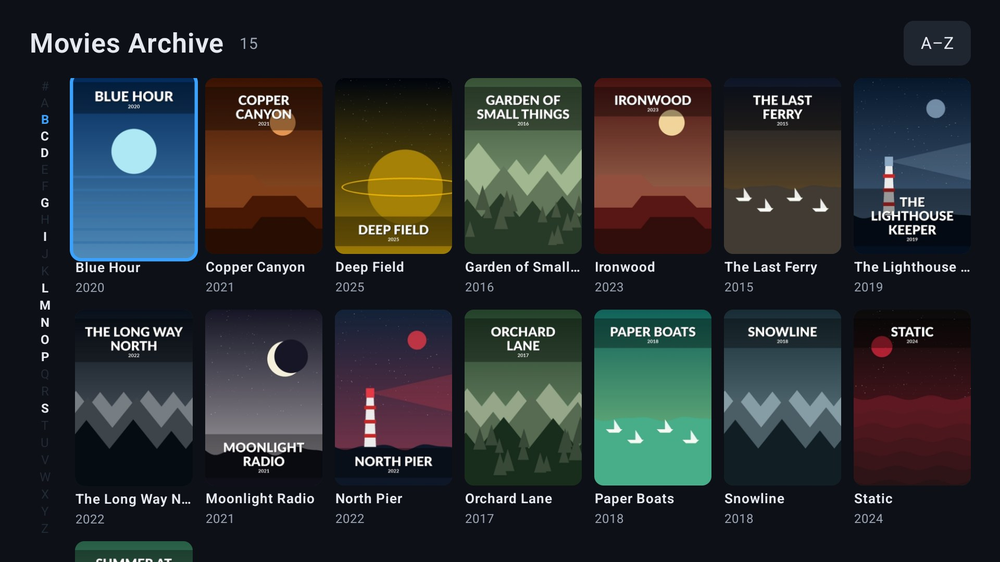 |
| Movie details | 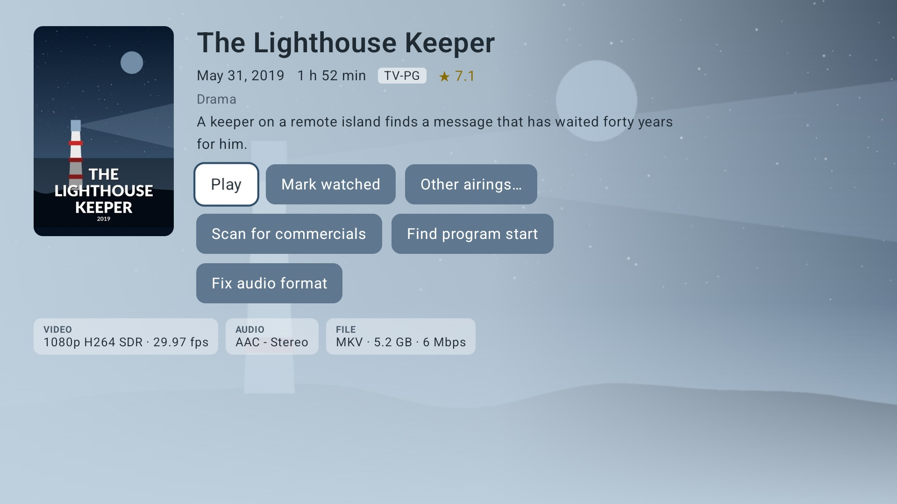 | 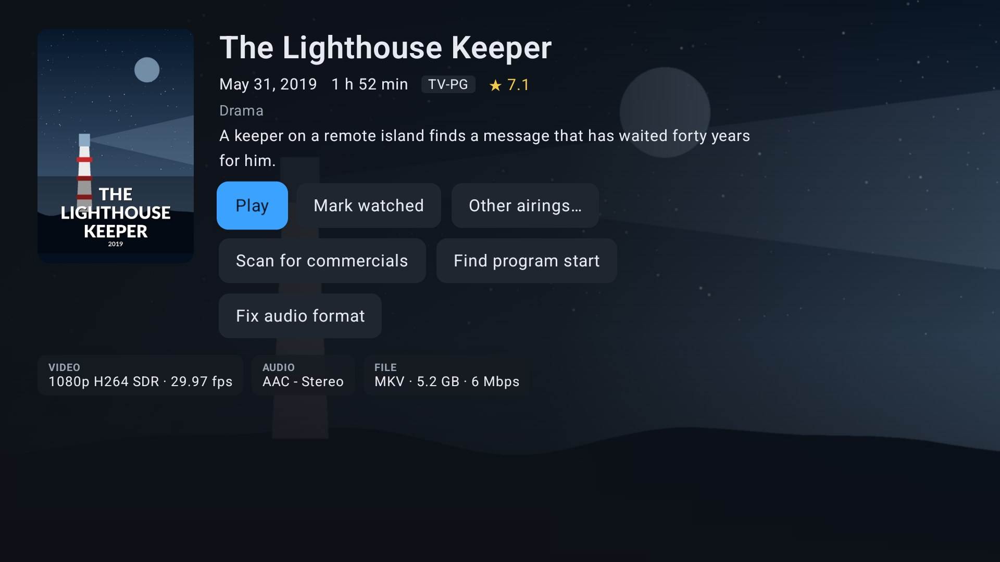 |

Playing a recording: commercial breaks (orange) and recap/intro (purple) marked on the seek bar,
with a skip prompt.

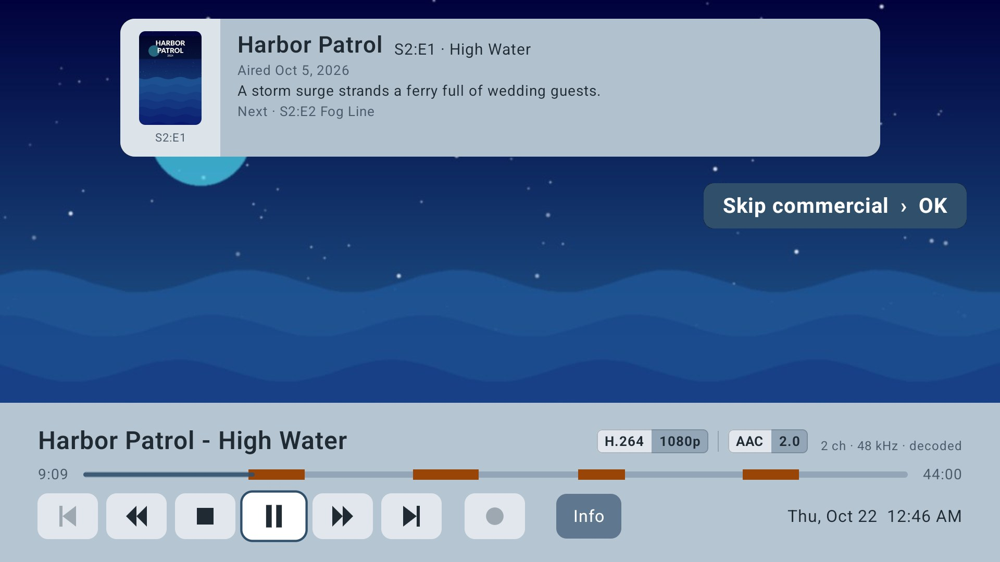

Build: `JAVA_HOME=~/opt/jdk21 ANDROID_HOME=~/Android/Sdk ./gradlew :app:assembleDebug`
(installs as `com.mackandall.jdvr.debug`, beside Wholphin).

GPL-2.0: `app/src/main/java/com/mackandall/jdvr/profile` comes from Wholphin / Jellyfin Android TV.
